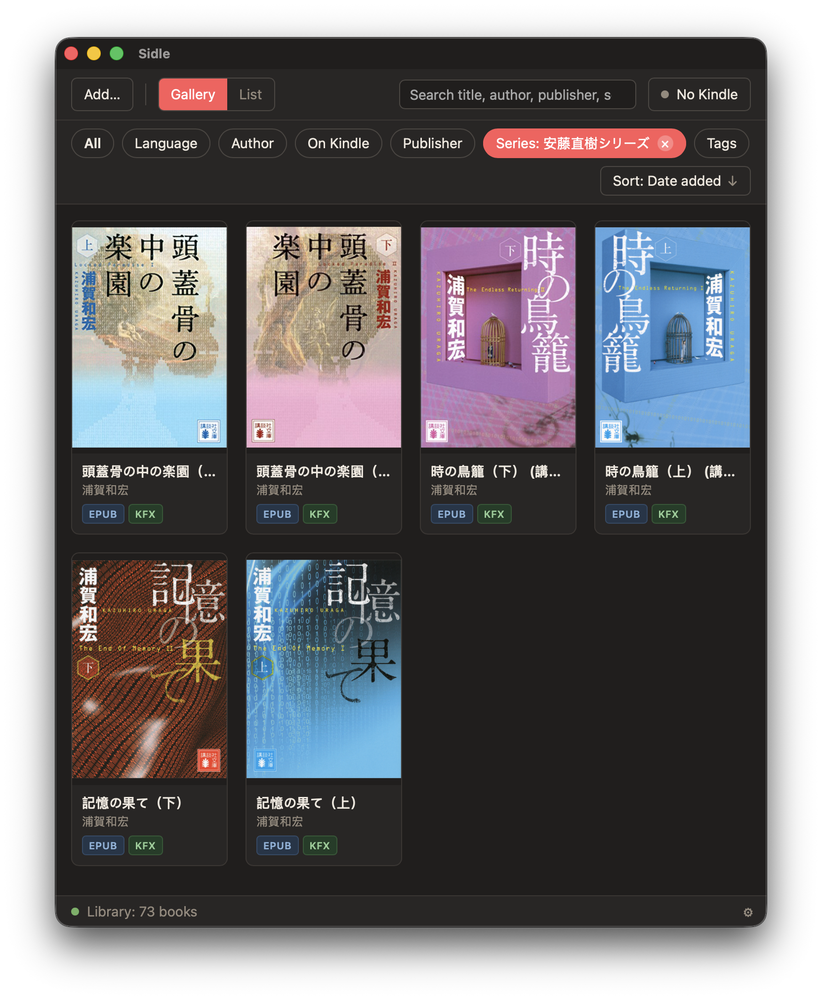
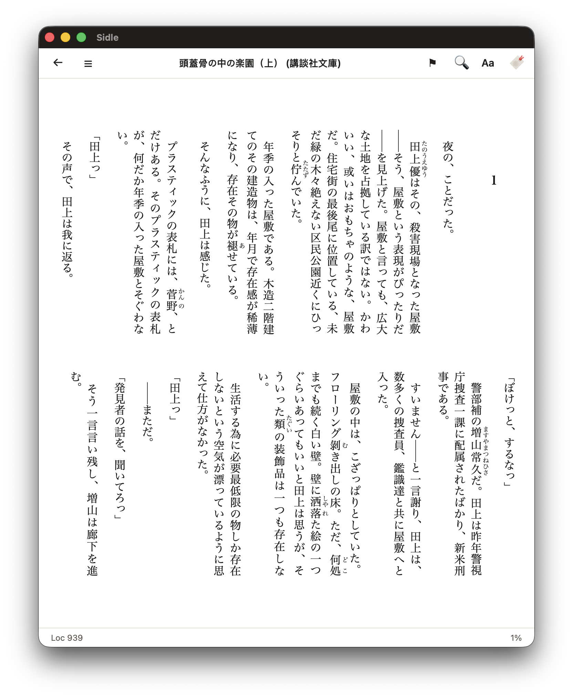
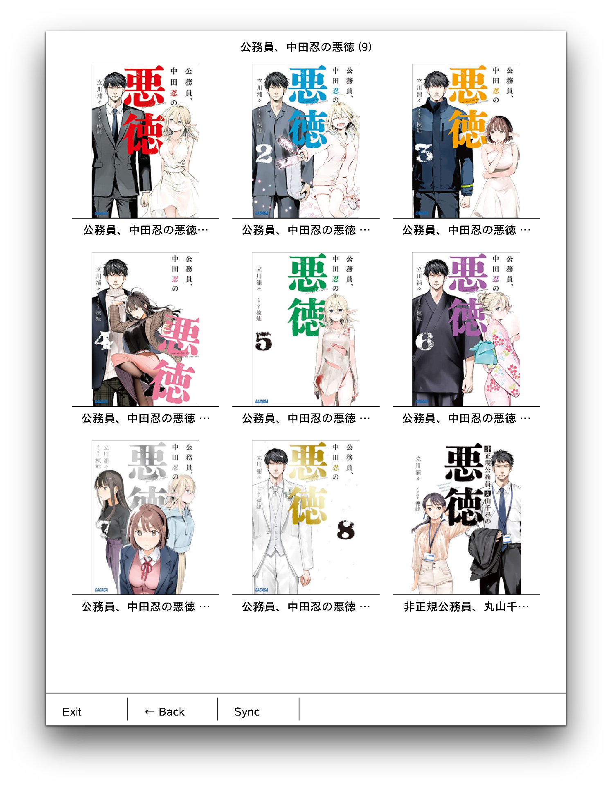

# Sidle 蛇行 / bokai 墨海

<p align="center">


</p>

`sidle` is a macOS book management app for sideloading/dumping books in and out of a (jailbroken) Kindle. Under the hood, [formats conversion](./bokai/README.md) is handled by `bokai`, a Japanese-focused fork of [boko](https://github.com/zacharydenton/boko). There's also a bonus: a [pure rust JPEG XR encoder/decoder](./jxr/README.md) as a standalone crate.

## Screenshots

<p align="center">
  
  
  
</p>

## Build

```sh
git clone https://github.com/huangziwei/sidle && cd sidle/
./build.sh
```

The app will be built and put into `/Applications/Sidle`

Book data and library database will be stored in `~/Library/Application Support/Sidle/`, and can be changed to other locations.

To install the Kindle native app for the first time, plug in the Kindle via USB, then in the Kindle tab, open `Kindle app` and click `Install on Kindle`. 

Tested on macOS 26 with Kindle Oasis 2 (9th Gen; 5.16.2.1.1), Kindle Colorsoft (1st Gen; 5.18.0.2), and Kindle Scribe (1st Gen; 5.19.4.0.1).
